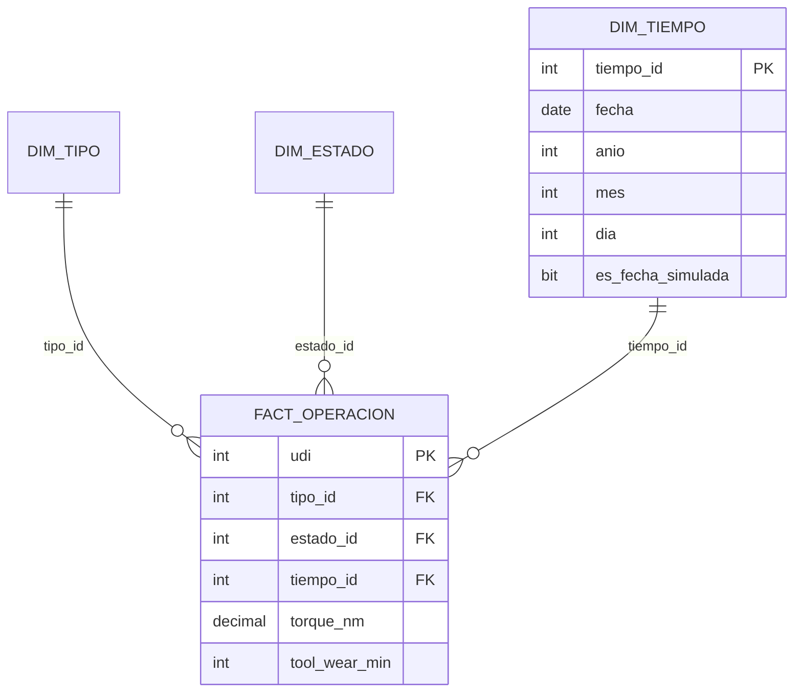

# Guía para ejecutar y presentar

Diego Salinas Laguna · AI4I 2020 · Actualización: 20 de noviembre de 2026.

Versión de apoyo para llevar a revisión: [Informe de arquitectura y estado, PDF](Informe_SQLServer_SSIS_PowerBI.pdf).

## 1. Qué estamos construyendo

Analizamos 10,000 observaciones sintéticas de operación industrial. Queremos entender las condiciones de trabajo, estimar el torque, identificar fallas y encontrar grupos de observaciones parecidas.

La nueva implementación prepara los datos con Python, organiza la ejecución mediante SSIS, almacena el modelo estrella en SQL Server y prepara un informe de Power BI conectado a esas tablas. El análisis previo en SQLite y el dashboard HTML se conservan como evidencia de la primera etapa.

## 2. Qué abrir y qué explicar

| Orden | Archivo | Explicación sencilla |
|---|---|---|
| 1 | `data/raw/ai4i2020.csv` | Este es el archivo original. Tiene 10,000 filas y 14 columnas y se conserva sin editar. |
| 2 | `notebooks/SalinasLaguna_Diego_U2_AE1_Exploracion.ipynb` | Aquí revisamos variables, nulos, duplicados, medias, medianas y gráficas. |
| 3 | `notebooks/02_ETL_SQLServer.ipynb` | Aquí mostramos la transformación y comprobamos cómo se asignan las fechas simuladas. |
| 4 | `ssis/AI4I_Carga_Full.dtsx` | Se genera en el equipo con SSIS siguiendo la guía de instalación. Sus cinco tareas ejecutan el flujo completo. |
| 5 | `sql/sqlserver/01_crear_datamart.sql` | Define la tabla central y las tres dimensiones. |
| 6 | `sql/sqlserver/03_consultas_presentacion.sql` | Permite comprobar las filas, las fallas y las relaciones después de cargar. |
| 7 | `powerbi/Mantenimiento.pbip` | Proyecto del informe de Power BI: indicadores, fallas por mes simulado y por tipo, con filtros. |
| 8 | `notebooks/Unidades_II_III.ipynb` y `notebooks/04_agrupamiento.ipynb` | Contienen los modelos supervisados y el agrupamiento de la etapa anterior. |

## 3. Cómo explicar el ETL

“Primero extraemos el CSV original. Luego revisamos que tenga las columnas correctas, que no falten valores y que los identificadores y las mediciones sean válidos. Renombramos las columnas y agregamos fechas simuladas con una regla fija. Los datos pasan a una tabla temporal de preparación llamada staging. Finalmente, SQL Server vuelve a validar, reemplaza los datos del modelo estrella y registra qué ejecución los cargó.”

Es una **carga FULL**: en cada ejecución se leen nuevamente las 10,000 filas y se reemplaza todo el contenido de hechos y dimensiones. No hay que borrar tablas a mano. El historial de cargas se conserva en `auditoria.cargas`.

La publicación ocurre dentro de una transacción: si falla antes de confirmar, SQL Server revierte los cambios y conserva el Data Mart anterior. Si falla la extracción, ni siquiera se llega al reemplazo. Las tareas siguientes de SSIS solo avanzan cuando termina correctamente la anterior. No equivale a una tarea programada por horario: es automático **al ejecutar** el paquete.

**Qué hace cada archivo:** `src/etl_sqlserver.py` prepara y valida los CSV; `scripts/sqlserver/Datamart.ps1` crea los objetos, envía staging, invoca la publicación y verifica; `sql/sqlserver/02_carga_full.sql` publica dentro de SQL Server; SSIS coordina esas tareas. El paquete usa tareas **Execute Process**, Python y PowerShell/SqlBulkCopy. No es una implementación con componentes nativos de Data Flow; si el profesor exige esos componentes, debe adaptarse el paquete.

## 4. Fechas y modelo estrella

Las fechas originales no existen en AI4I. Para esta práctica asignamos 50 observaciones por día, ordenadas por UDI, desde el 1 de enero de 2026. La fórmula es `2026-01-01 + floor((UDI - 1) / 50)` días. Del UDI 1 al 50 corresponde el 1 de enero; del 51 al 100, el 2 de enero. El último día con observaciones es el 19 de julio de 2026.

La dimensión contiene los 365 días de 2026, de los cuales 200 tienen observaciones. Cada fila de hechos conserva `tiempo_id` para relacionarse con la fecha. La **fecha de carga real**, guardada en UTC, es otro campo: no se mezcla con la fecha simulada de operación.

“La tabla central guarda una observación por UDI con sus mediciones. Alrededor tiene dimensiones que explican el tipo de producto, su estado de falla y la fecha simulada. Power BI usa esas relaciones para filtrar los indicadores.”

Las gráficas mensuales sirven para demostrar filtros y relaciones. **No demuestran estacionalidad real ni predicción futura**, porque ese calendario fue agregado para la práctica. Las fechas simuladas no se agregan como variables de entrada a los modelos previos.

## 5. Calidad y variables

Hay cero nulos y cero filas completamente duplicadas en el original. Hay 339 observaciones con falla y 27 discrepancias entre la etiqueta general y los indicadores específicos; se conservan y se documentan. Los puntos fuera de los bigotes de los boxplots son posibles valores atípicos y no se eliminan automáticamente. La línea dentro de cada caja representa la mediana.

Las mediciones principales son temperatura del aire y del proceso, velocidad de rotación, torque y desgaste de herramienta. `Type` contiene L, M y H, categorías de calidad de producto baja, media y alta. No son calificaciones de la calidad del archivo ni estados de avería.

Pandas se usa con `read_csv`, `head`, `info`, `describe`, `isna`, `duplicated`, `groupby`, `rename`, `to_numeric`, `sort_values` y `to_csv`. En el nuevo notebook se ven comprobaciones concretas; los nombres exactos de cada instrucción se pueden buscar en sus celdas.

## 6. Las tres propuestas

**Regresión:** estimar cuánto torque tiene una observación a partir del tipo, las temperaturas, las revoluciones y el desgaste. Torque es la respuesta que queremos estimar y se excluye de las entradas.

**Clasificación:** estimar si una observación presenta falla, usando el tipo y las cinco mediciones. La respuesta es `Machine failure`. Los indicadores TWF, HDF, PWF, OSF y RNF quedan fuera de las entradas para evitar revelar la respuesta.

**Agrupamiento:** reunir observaciones con mediciones parecidas usando las cinco mediciones, estandarizadas. Se obtuvieron tres grupos; las etiquetas de falla se consultan después para describirlos y no para crearlos. UDI, identificador de producto y fechas simuladas no se usan para entrenar.

## 7. Orden de demostración

1. Abrir el notebook de exploración y mostrar la calidad y un boxplot.
2. Abrir el nuevo notebook de ETL y ejecutar las celdas.
3. Mostrar el paquete en Visual Studio con Integration Services, una vez generado.
4. Ejecutar el paquete; revisar las cinco tareas en verde y conservar la salida de verificación.
5. Consultar SQL Server: deben existir 10,000 hechos, 3 tipos, 2 estados y 365 fechas; 339 fallas y 200 días con datos.
6. Repetir la carga: deben seguir siendo 10,000 hechos y aumentar una fila en el historial de cargas.
7. Abrir Power BI, actualizar los datos, mostrar la vista Modelo y probar los filtros.

La instalación y los comandos están en [INSTALACION_SQLSERVER_SSIS_POWERBI.md](INSTALACION_SQLSERVER_SSIS_POWERBI.md). No presentar como ejecutadas las etapas que todavía estén pendientes en ese documento.
